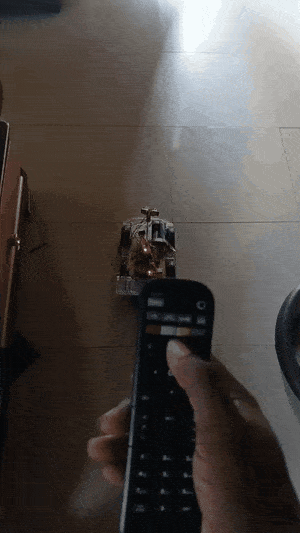
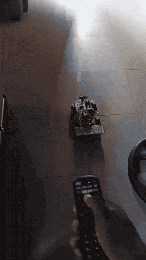
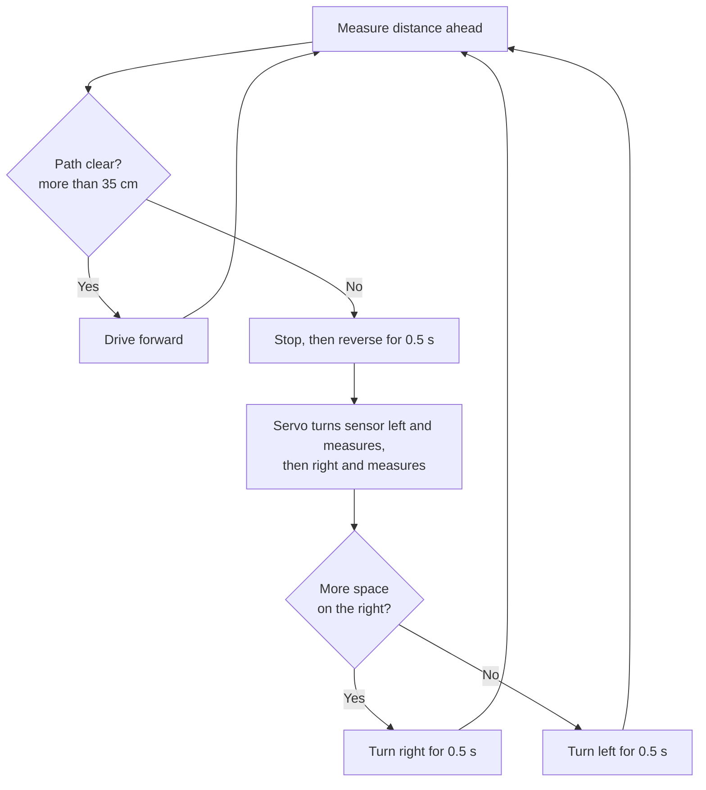
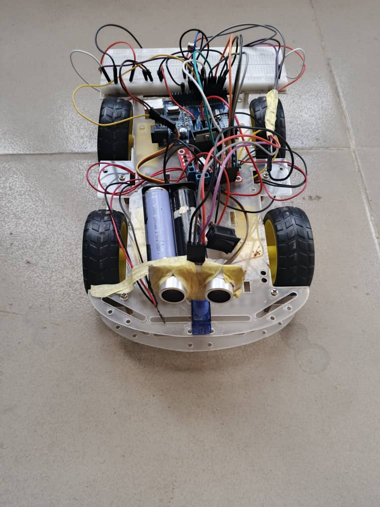
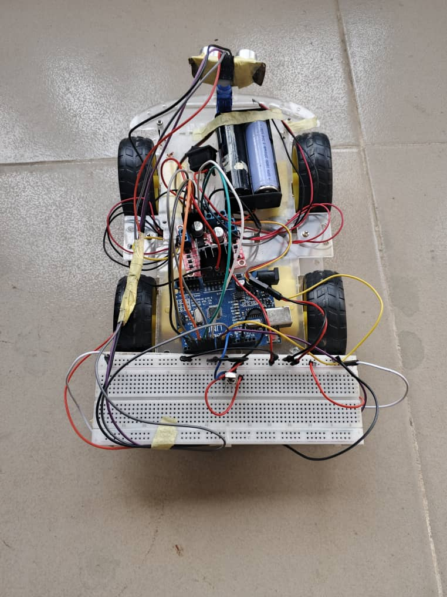
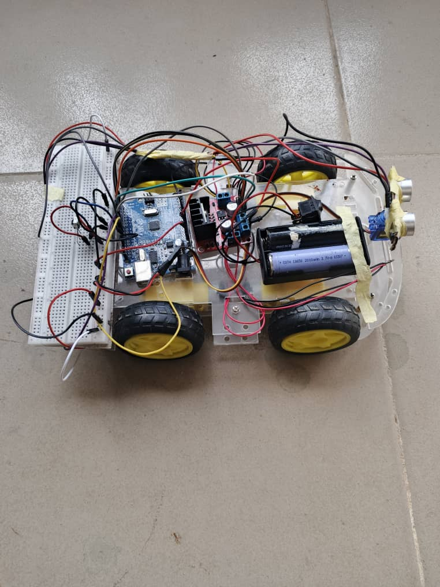
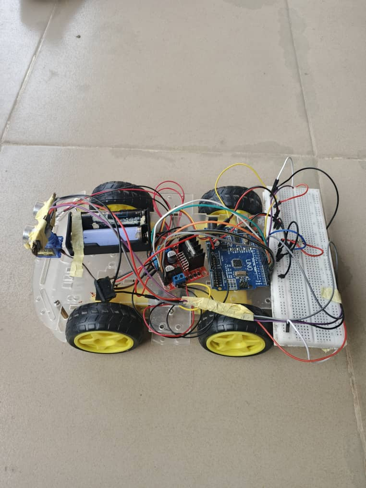

# Remote-Controlled Autonomous Car

A 4-wheel-drive Arduino robot car with two modes: **manual control** from an IR remote, and an **autonomous obstacle-avoidance mode** where it drives on its own, scans left and right with a servo-mounted ultrasonic sensor when something blocks its path, and turns toward the side with more space.

| Manual mode | Autonomous mode |
|:-----------:|:---------------:|
|  |  |

🎥 [Full project walkthrough](https://youtu.be/I1xxW7EgW1c)

## Problem / Goal

Most beginner robot cars are either fully remote-controlled or fully autonomous. The goal of this project was to build one car that can do both and switch between them instantly from a single remote: drive it manually when you want control, or press one button and let it navigate around obstacles by itself. It was built from individual components (chassis, motor driver, sensors, microcontroller) rather than a pre-programmed kit, so all the control logic is my own.

## How It Works

### Manual mode (IR remote)

The IR receiver decodes each button press, and the car responds:

| Remote button | Action |
|---------------|--------|
| Forward | Drive forward while the button is held |
| Back | Reverse while the button is held |
| Left | Turn left on the spot while the button is held |
| Right | Turn right on the spot while the button is held |

**How hold-to-drive works:** each signal the car receives moves it for 200 ms and then stops it. While a button is held down, the remote keeps sending the signal repeatedly, so these short moves join into continuous motion. As soon as the button is released, the signals stop and the car stops within 200 ms. In manual mode this also acts as a safety feature: if the remote goes out of range or the signal is blocked, the car stops by itself instead of driving away.

### Autonomous mode

Once **OK button ** is pressed, the car keeps running in autonomous mode until another button is pressed.Pressing any direction button however takes it out of autonomous mode and back to manual control.

Distance is calculated from the echo time of the HC-SR04: `distance (cm) = time (µs) × 0.0343 / 2`, using the speed of sound (343 m/s) and halving it because the pulse travels to the obstacle and back.

## Design Decisions

- **Servo-mounted ultrasonic sensor** instead of three fixed sensors: one HC-SR04 on an SG90 servo can look forward, left (180°) and right (0°), which gives the car side-to-side awareness with fewer parts and less wiring.
- **Compare left vs right before turning**, rather than always turning the same way, so the car picks the more open direction instead of getting trapped in corners.
- **Reverse before scanning:** backing up for 0.5 s gives the car room to turn without hitting the obstacle it just detected.
- **35 cm stopping threshold** gives the car room to stop and reverse before it reaches the obstacle.
- **L298N dual H-bridge motor driver** controls the two sides of the car independently, allowing forward, reverse and on-the-spot turning (one side forward, the other backward).
- **PWM speed of 200/255** instead of full speed, to reduce current draw and keep the car controllable (see the problems below).
- **Echo timeout of 25 ms** in `pulseIn()` (instead of the default 1 second), so a missing echo only delays the program briefly. 25 ms still covers distances of about 4 m, well beyond what the car needs.
- **IR remote** as the controller: cheap, simple to decode with the IRremote library, and needs no app or wireless module.

## What Went Wrong and How I Fixed It

**1. The sensor returned 0 when nothing was in range.**
When there was no obstacle within range, no echo came back before the timeout, so `pulseIn()` returned 0. The code read this as an object at 0 cm and the car kept stopping and turning in open space.

**Fix:** A reading of 0 is now treated as a clear path (front distance set to 100 cm), so the car keeps driving forward when nothing is ahead.

**2. The motors stalled and a wire burned.**
The motors drew too much current, which caused them to stall and burned one of the wires.

**Fix:** Replaced the battery and reduced the motor speed (PWM 200 out of 255), which brought the current down to a safe level while keeping enough power to drive all four wheels.

## Results

- Switches between manual and autonomous mode from the remote.
- In autonomous mode, detects obstacles ahead, reverses, scans both sides and turns toward the more open side.
- After the fixes, drives steadily in open space without false stops, and the motors no longer stall.

## Hardware Used

- Arduino Uno
- L298N dual H-bridge motor driver
- 4 × DC gear motors (TT motors) on a 4WD acrylic chassis
- HC-SR04 ultrasonic distance sensor
- SG90 servo motor (sensor mount)
- IR receiver module + IR remote
- 2 × 18650 Li-ion cells (3.7 V, 2000 mAh each) in a battery holder
- Rocker power switch
- Breadboard and jumper wires

## Pin Configuration

| Component | Arduino Pin |
|-----------|-------------|
| L298N ENA (motor side A speed) | 5 (PWM) |
| L298N ENB (motor side B speed) | 6 (PWM) |
| L298N IN1 | 7 |
| L298N IN2 | 3 |
| L298N IN3 | 4 |
| L298N IN4 | 2 |
| Servo signal | 9 |
| Ultrasonic Trig | 8 |
| Ultrasonic Echo | 10 |
| IR receiver signal | 11 |

## How to Run

1. Install the **IRremote** library (by Armin Joachimsmeyer, version 4.x) from the Arduino IDE Library Manager. The `Servo` library comes with the IDE.
2. Wire the components as shown in the pin table above.
3. Open `REMOTE_CONTROLLED_AUTONOMOUS_CAR.ino` in the Arduino IDE.
4. Select **Arduino Uno** as the board and the correct port under **Tools**, then upload.
5. **Your remote's button codes may be different.** Open the Serial Monitor (9600 baud), press each button, and replace the codes in the `if (buttonCode == ...)` lines with the numbers you see.
6. Switch on the battery. Press **ON** for autonomous mode, **OFF** to stop, or use the direction buttons to drive manually.

## Future Improvements

- Make the remote respond instantly during obstacle avoidance by replacing `delay()` with non-blocking timing using `millis()`.
- Apply the same "0 means clear" check to the left and right scans.
- Add speed control buttons on the remote.
- Replace the IR remote with Bluetooth or Wi-Fi (e.g. ESP32) for phone control and longer range.
- Move from the breadboard to a soldered board for more reliable connections.

## Photos

 

 

